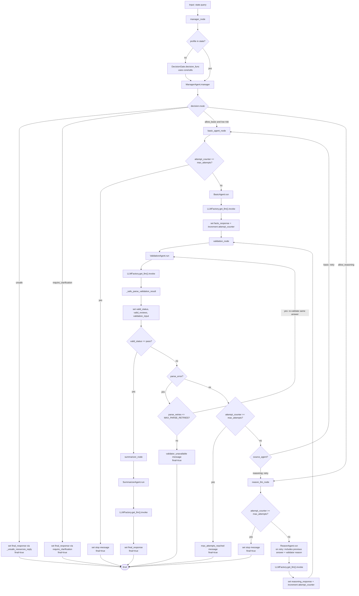
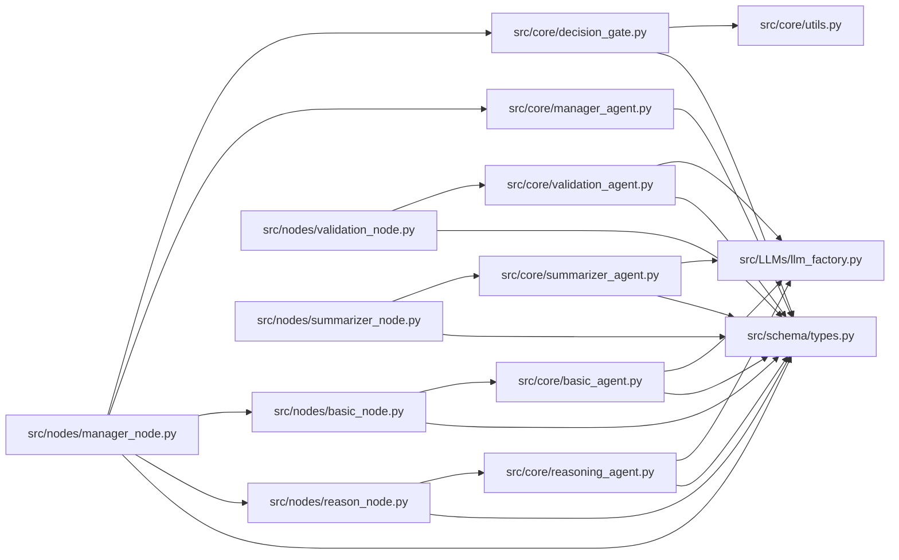

# Finance Decision Reasoning Flow Diagram

Scope used for this diagram:
- `src/core`
- `src/nodes`
- `src/LLMs`
- `src/schema`
- `src/agents` (currently not present in repo)

## 1) Runtime Pipeline Flow

## 2) Module Interaction Flow

